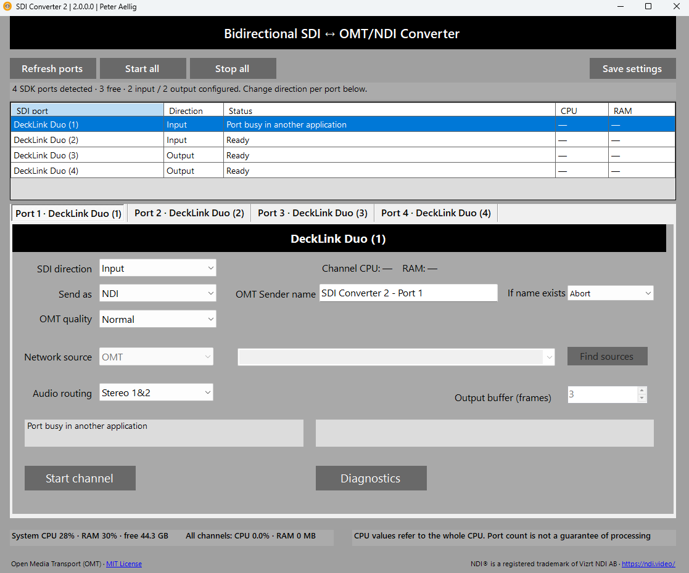

# SDI Converter 2

Windows multichannel converter: Blackmagic SDI to OMT / NDI, and OMT / NDI to SDI.

Each active SDK port has one configurable channel and its own C++ engine process.
This is the multichannel successor to SDI Converter.

## Installation (ClickOnce)

[Download the Windows x64 ClickOnce installer ZIP](https://media.githubusercontent.com/media/peteraellig/SDI_converter2/main/install/SDI-Converter_multichannel.zip)

1. Download the ZIP (approximately 130 MiB) and extract it completely into a folder.
2. Run `setup.exe` from that folder. Keep `Application Files` and the `.application` file alongside it.
3. Install Blackmagic Desktop Video and, for NDI features, the free NDI Tools separately.

The installer package is stored in [`install`](install) using Git LFS. To obtain the ZIP through a Git clone,
install Git LFS and run `git lfs pull`. The direct download link above does not require Git.

## Run

Open `app\SdiConverter2.exe`. Requires Windows x64, .NET 8 Desktop Runtime, Blackmagic Desktop Video,
and the NDI runtime when using NDI. NDI runtime is not bundled. No streams start automatically.

Depending on the Blackmagic SDI card, you can configure the ports as inputs or outputs. Change direction per tab;
choose a network source for each output. Only directions reported by the current SDK/card profile are offered.
Desktop Video Setup controls which sub-devices/connectors are available; the application does not change
card profiles or cabling. An SDK port is not necessarily an independently configurable physical connector.

Use Start/Stop per channel, Start all, or Stop all. The overview stays visible across tabs.
Settings persist in `%APPDATA%\SDI Converter 2\channels.json` on Save, channel start and normal exit.
SDK persistent identities track ports across enumeration changes; older devices fall back to indices,
so verify assignments after hardware changes. Refresh ports is available while all channels are stopped.
Busy/unverified ports are rejected. A named mutex reserves each port across version-2 engine processes
in the same Windows session, including while an output waits for its source. Driver busy checks remain.

## Processing capacity

Displays system CPU/RAM, combined channel CPU/RAM, and per-channel CPU/RAM. CPU uses total machine capacity.
A single saturated core or network bottleneck can cause frame loss even with low overall CPU.
System CPU at least 85% for five samples generates an advisory, not a benchmark or automatic stream limit.
Frame/audio loss and late/dropped output frames are visible. Port count does not predict sustainable streams.
The C++ media path and native codec libraries remain. No GPU codec path was added; GPU memory alone cannot
 offload compression. This release adds concurrency and monitoring, not a claim of reduced CPU per stream.

## Build

Requires Visual Studio 2026 with the C++ desktop workload (MSVC, ATL, Windows SDK and CMake),
the .NET 8 SDK, and Blackmagic Desktop Video. Clone the repository, then run
`powershell -ExecutionPolicy Bypass -File scripts\build-app.ps1` from its root.
The resulting executable is `app\SdiConverter2.exe`; keep the accompanying files with it.

Open `SdiConverter.sln` in Visual Studio. New UI: `MultiChannelForm` and `ChannelControl`, with separate
Designer files. The unused single-channel forms/settings have been removed. Build outputs use `%LOCALAPPDATA%\sdi_converter2`;
settings, assembly identity and publish paths are separate from version 1.
`scripts\build-app.ps1` builds the runnable `app` folder. A prebuilt ClickOnce package is available in the Installation section above.
The supplied ZIP was checked for archive integrity; installation was not tested as part of its upload.

## Validation

`scripts\test-channels.ps1` builds a fake engine and STA WinForms harness into the isolated
`%LOCALAPPDATA%\sdi_converter2\channel-tests` folder. Fifteen checks cover four parallel processes,
3-in/1-out defaults, health on hidden tabs, per-channel memory, independent stop/restart, stop-all,
busy/disconnected ports, reordered enumeration, stop during startup, immediate failure, missing configuration,
and settings persistence. The harness uses its own fixture settings.
Run `ChannelHarness.exe` without `--test` for a clearly labelled simulated-port preview.
Never copy the fake engine into the production build or `app` folder.

2026-11-01: Release build and all 15 checks passed; empty-card and four-port layouts visually checked.
Real engine discovery returned `[]` on this computer. Hardware throughput, actual CPU capacity, SDI routing
and simultaneous OMT/NDI quality still require a connected card.
Hardware acceptance: verify profile/free ports, add real streams one at a time, record CPU, encode P95,
loss/late frames and network load at intended formats. Run the intended 3-in/1-out setup for at least
30 minutes, including channel restarts and format changes.

## License

Own code: 0BSD. See LICENSE and THIRD-PARTY-NOTICES.md. OMT retains its MIT license.
NDI is a registered trademark of Vizrt NDI AB.
